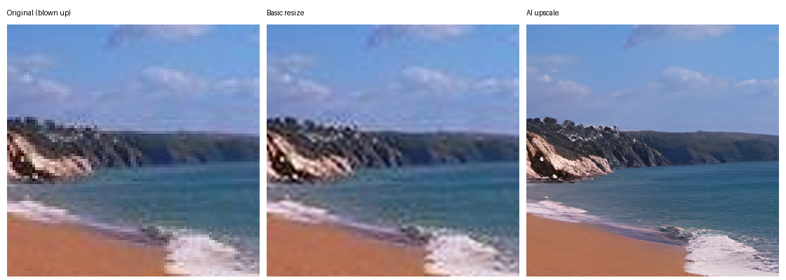
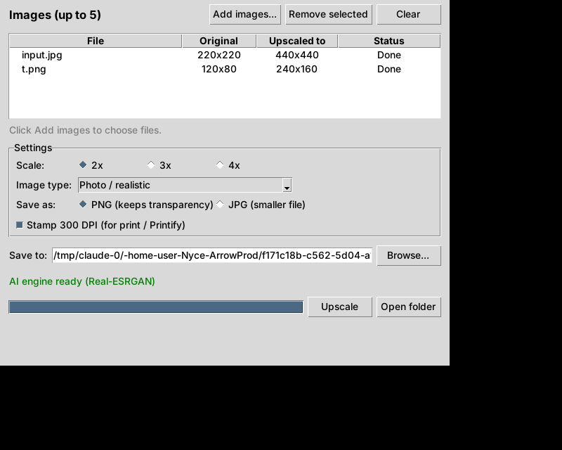

# Bulk Upscaler

A desktop app that AI-upscales up to 5 images at a time (2x, 3x or 4x). It runs
on your own computer. No uploads, no credits, no monthly fee.



## How it works

Canva's upscaler (like most "AI upscale" tools) uses a super-resolution neural
network: a model trained to guess the missing detail when an image is enlarged.
Canva's own model and servers are private, so this app does the same job with
the open-source [Real-ESRGAN](https://github.com/xinntao/Real-ESRGAN) model
(BSD-3-Clause license, fine for commercial use).

```
your images (up to 5)
      |
      v
Real-ESRGAN runs 4x on your graphics card, one image at a time
      |
      v
resized to the scale you picked (2x / 3x / 4x)
      |
      v
saved as PNG or JPG, stamped 300 DPI if you want it print-ready
```

## Install

You need Python 3.10 or newer from [python.org](https://www.python.org/downloads/)
(on Windows, tick "Add Python to PATH" during install).

- **Windows:** double-click `start-windows.bat`
- **Mac:** double-click `start-mac.command` (first time: right-click, Open)

The first launch sets things up and downloads the AI engine (about 50 MB).
After that it opens straight away.

Manual setup instead:

```
pip install -r requirements.txt
python setup_engine.py
python app.py
```

## Using it

1. Drag images onto the list, or click **Add images** (PNG, JPG, WEBP).
2. Pick the scale and the image type:
   - **Photo / realistic** for product photos and lifestyle shots
   - **Graphic / illustration / logo** for designs, flat art, text
   - **Fast** when you need speed over detail
3. PNG keeps transparent backgrounds. JPG flattens onto white.
4. Click **Upscale**. Files save as `name_upscaled_4x.png` and never overwrite
   anything.



## Notes

- Any modern GPU works (NVIDIA, AMD, Intel, Apple Silicon) through Vulkan.
  No GPU means it runs on the CPU, slower but same quality.
- If the engine is missing the app falls back to basic resizing and tells you.
- 300 DPI is just a label. Real print size depends on pixels: a 4500 x 5400
  image prints 15 x 18 inches at 300 DPI.

## Tests

```
pip install pytest
python -m pytest tests
```
